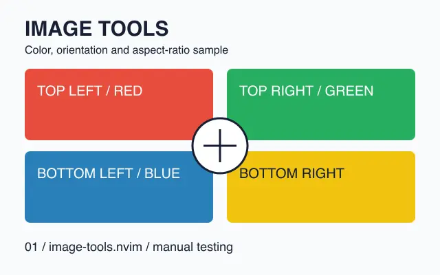
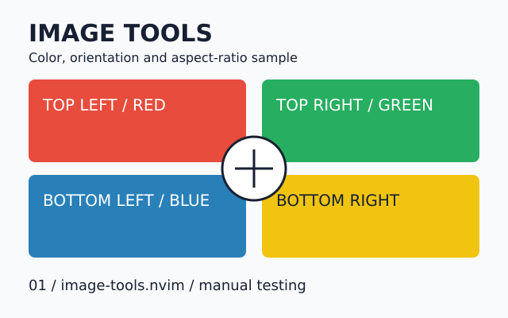
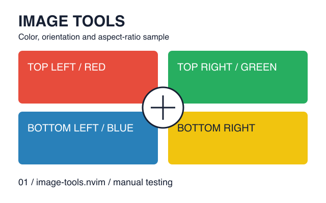
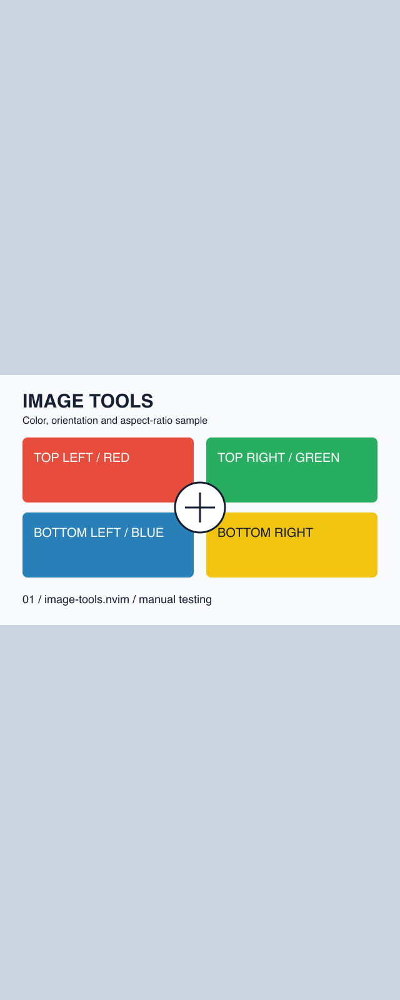

# Manual test gallery

These small, bundled files are for trying image-tools.nvim after installation.
They are generated locally from simple color patterns; no downloads or personal
images are required. Run commands below from the repository root in a direct
Kitty session. See [requirements](../README.md#requirements) for Neovim and tools.

Open this file with `nvim examples/README.md`, then move onto any image link below
or run `:ImagePreview` on its line. The preview should preserve the aspect ratio,
show readable corner labels, and disappear when you leave the line. JPEG/AVIF/HEIC
are lossy, so slight color or edge differences are expected.

For an isolated editor that loads this checkout instead of your user config:

```sh
nvim -u NONE -i NONE --noplugin \
  -c "lua vim.o.termguicolors=true; vim.opt.rtp:prepend(vim.fn.getcwd()); require('image_tools').setup()" \
  examples/README.md
```

## Image formats

All baseline images are 640 x 400 pixels and show the same four-color pattern.
PNG previews need no converter. Other raster formats require ImageMagick with
the relevant codec; SVG prefers `rsvg-convert` and falls back to ImageMagick MSVG.
AVIF/HEIC support depends on the installed ImageMagick build.

### PNG


### JPEG (.jpg and .jpeg)


### WebP



### AVIF


### HEIC


### GIF

This file has two frames. The plugin should display only the first frame, labeled
`IMAGE TOOLS`; it should not animate or switch to `FRAME TWO`.


### BMP


### TIFF (.tif and .tiff)


### SVG

SVG is excluded from automatic file-buffer interception by default. Use this
reference, `:ImagePreview examples/images/sample.svg`, or
`:ImageOpen examples/images/sample.svg`.



## Transparency, dimensions and paths

The transparent PNG has transparent space around the colored shapes and labels;
the editor background should show through it.



The wide image is 1600 x 400; the tall image is 640 x 1600. Their color boards sit
in the middle of a gray canvas. Open them with `:ImageOpen`, zoom with `+` / `-`,
pan with the arrow keys, and reset with `0`.




This copy of the baseline PNG tests spaces and non-ASCII characters in paths.
The Markdown destination uses angle brackets; command arguments accept literal
spaces without shell quotes:
`:ImagePreview examples/images/sample space 中文.png`.


## Three-page PDF

ImageMagick with Ghostscript renders PDF; Poppler's `pdfinfo` provides page counts
for file-buffer paging. Floating and picker previews show page 1 only.


Run `:ImageOpen examples/sample.pdf`, then use `]p` / `[p` to check these pages:

| Page | Expected content |
| --- | --- |
| 1 | Portrait page, red marker, four-color image |
| 2 | Landscape page, green marker, wide image |
| 3 | Portrait page, blue marker, numbered grid 1-24 |

Zoom and pan on page 3, then reset with `0`. Run `:ImageInfo` to inspect the
current page, dimensions and cache state. Close/reopen a preview to try cache
reuse; resize or switch splits to check clipping and cleanup.

The PDF source, [sample.typ](sample.typ), also contains local Typst image
references for cursor-preview testing.

## Formula previews

Open [math.md](math.md) to try inline/display formulas,
fractions, roots, matrices and aligned equations. Install latex, dvipng and the
amsmath/amssymb packages. Move across formula rows, edit the body and leave its
range to check update/cleanup. The background should be transparent, and code or
comment examples should not preview. Use `:ImageInfo` for errors and dimensions.

For [math.tex](math.tex), enable `formula_preview` in tex-tools.nvim and use
`:TexToolsFormulaPreview` / `:TexToolsFormulaInfo`.

## Inline display

Open [inline.md](inline.md) with `inline = { enabled = true }`, or enable it using
`:ImageInlineToggle`. This gallery reuses bundled images and covers standalone
images, reference links/wikilinks, block formulas, split widths, wrapping, folds,
partial scrolling and excluded code. Source text should remain unchanged. Use
`:ImageInfo` on a source reference and `status().inline` for state/errors.

## Regeneration

All examples are original synthetic test patterns, distributed under the
repository's license. The checked-in media work without running a generator.
To regenerate them, install Python 3, librsvg (`rsvg-convert`), ImageMagick with
AVIF/HEIC encoding support and Typst, then run:

```sh
python3 examples/generate.py
```

The generator overwrites only its named assets and `sample.pdf`. Encoded bytes
can vary with tool and codec versions. These files supplement the small fixtures
under `tests/fixtures/`; they do not establish that rendering has been validated
on a particular terminal. See [manual acceptance](../doc/testing.md#real-kitty-acceptance).
