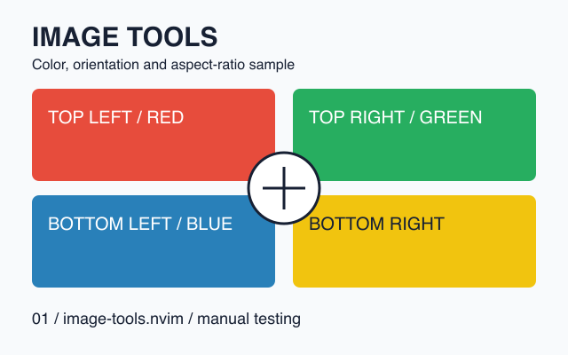
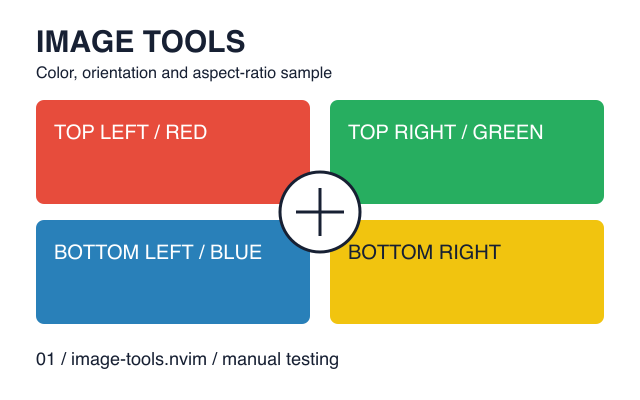
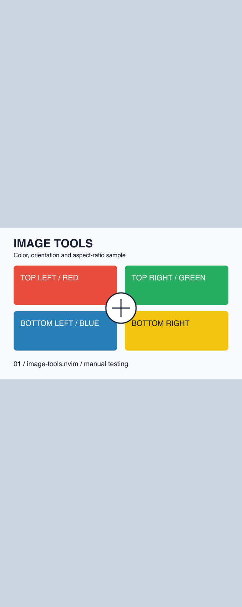

# Inline Markdown gallery

Enable `inline = { enabled = true }`, or run `:ImageInlineToggle` when it is off.
The source stays visible; images/formulas appear in virtual lines below it.
Use a direct Kitty session with Neovim 0.12+. PNG needs no converter; formulas
need latex, dvipng and amsmath/amssymb. No network access is needed.

An isolated session from the repository root:

```sh
nvim -u NONE -i NONE --noplugin \
  -c "lua vim.o.termguicolors=true; vim.opt.rtp:prepend(vim.fn.getcwd()); require('image_tools').setup({inline={enabled=true}})" \
  examples/inline.md
```

## Native image



Scroll using `<C-e>` / `<C-y>`: the image should remain partially visible as its
source line leaves the viewport. Continue scrolling to release the placement;
returning should reuse cached pixels.

## Transparency and aspect ratios






Try `:vsplit` and `:vertical resize 35`. Each split should fit its own text width.
Toggle wrapping with `:setlocal wrap!`, add line numbers with `:setlocal number`,
and check that virtual lines stay inside the text area. Closing one split must
retain the other split's image. Floating menus should cover the image normally.

## Reference images and wikilinks

![Reference image][board]

![[images/sample space 中文.png|Unicode asset]]

[board]: images/sample.png "Shared board"

## Block formulas

$$
\frac{a+b}{c+d} + \sqrt{x^2+y^2}
$$

\[
\begin{bmatrix}1 & 2 \\ 3 & 4\end{bmatrix}
\]

\begin{align*}
f(x) &= x^2 + 2x + 1 \\
     &= (x+1)^2
\end{align*}

Change the formula or colorscheme to refresh it. The formula source remains
editable. `:ImageInfo` on its source should report ready/error state; manual
`:ImagePreview` still works. With `:setlocal foldmethod=manual`, use `zfap` on an
image paragraph to fold it, then `zo` to reopen. Folded images should disappear.

## Floating-only and excluded examples

This image is part of prose: .

$a^2+b^2$ is inline math; it keeps its floating preview.

 

The following code must not produce inline images or formulas:

```markdown

$$x^2$$
```

    

Run `:ImageInlineToggle` to remove virtual lines without modifying this file.
